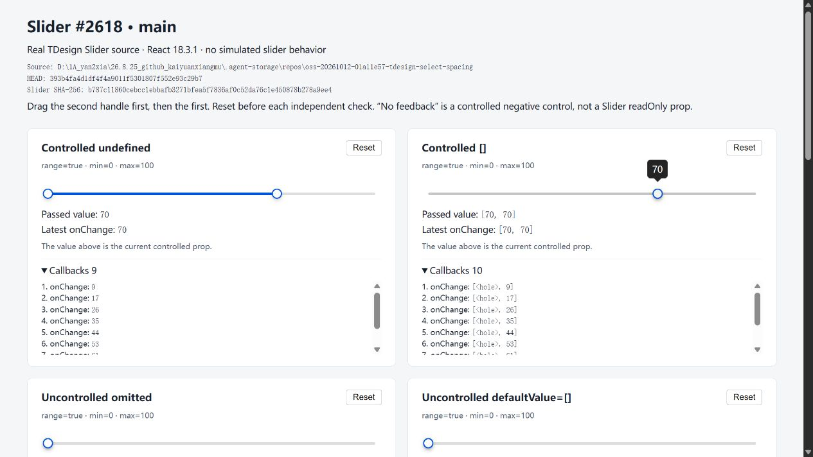
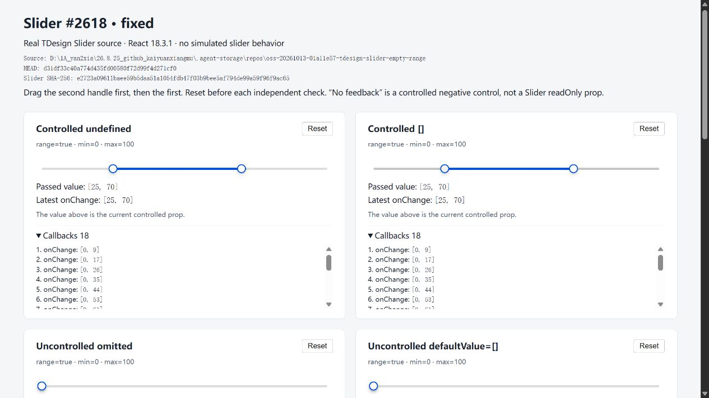

# Slider empty-range browser verification

Source fix: `14d7c0ccbb67d8c5bd2b0ead0c0bc682b18007b4` (Tencent/tdesign-react issue #2618).
Baseline Slider source: `d31df33c40a774d435fd00580f72d99f4d271cf0`.

These are unedited screenshots captured after actual mouse interactions with the real Slider component and matching common styles, using React 18.3.1.

## Baseline

Dragging an empty range initialized as undefined emits a scalar. An empty array emits an array with a missing endpoint during the drag.

## Fix

Both controlled empty-value cases emit `[0, 70]` when the second handle is dragged, then `[25, 70]` when the first handle is dragged.

The fixed bundle was built before the local commit, so its header records the earlier Git HEAD. Its Slider source hash (`e2723a09611baee59b5daa51a1054fdb47f03b9bee5af794de99a59f96f9ac65`) and all component inputs match the final committed fix. The baseline bundle's selected component inputs were checked against the baseline commit; its hosting checkout also contained an unrelated earlier contribution.

Browser checks covered 11 fixture cases: controlled and uncontrolled empty ranges, normal pairs, scalar values, nonzero minimum, controlled values without feedback, and disabled values. A rail click from coincident endpoints also produced a complete pair. Browser console checks reported no errors or warnings.

The 34 passing unit tests additionally cover marks, negative/dynamic minimums and subsequent defaultValue changes; these additional cases were not exercised in this browser fixture. This is focused verification, not a full workspace build or test run.
