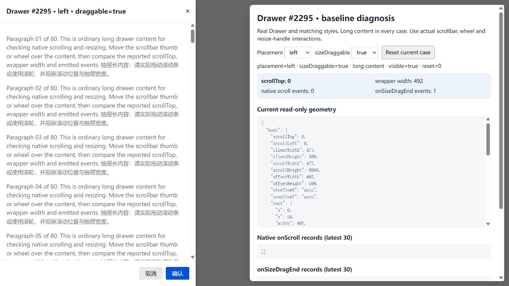
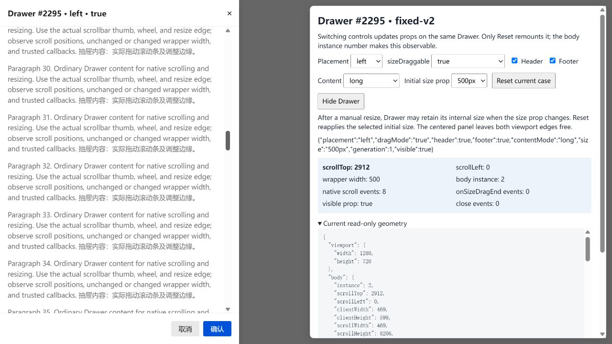

# Drawer #2295 browser verification

Source fix: [4ec98f4](https://github.com/dvd233/tdesign-react/commit/4ec98f478624069e5c8af6bc985bfff5170e2ad5)

Base: `d31df33c40a774d435fd00580f72d99f4d271cf0` (Tencent/tdesign-react develop).
The screenshots capture real Drawer source and matching common styles in Windows Chromium with React 18.3.1, using actual native mouse drags.

| Native vertical scrollbar drag | Before | After |
| --- | --- | --- |
| scrollTop | 0 | 2912 |
| Wrapper width, initially 500px | 492px | 500px |
| onSizeDragEnd calls | 1 | 0 |

Both fixtures use a left, resizable, 500px Drawer with 80 paragraphs. The later fixture adds diagnostic controls and changes paragraph wording; these screenshots compare interaction behavior, not scrolling distance or performance.

The final source also passed 12 real-browser scenarios: native vertical and horizontal scrolling; wheel; live drag enable/disable and placement changes on the same body node; no-header/no-footer scrolling, body-edge resizing and closing; short-to-long content; object min/max limits; and resizing back from full width and the existing 8px minimum. Native scrollbar gestures did not emit resize callbacks. Body-edge drags still did.

The implementation reserves the existing 16px resize area from the body width for left resizable Drawers. With no header, the close button moves with the body. Content can wrap differently. The no-header close button keeps its ordinary relative geometry; this is not a claim that every scrollbar pixel is unobstructed.

Existing Drawer tests: 12 passed. Original development TypeScript config passed. Changed-file ESLint/format rules passed. React act warnings and the TypeScript 6 / older ESLint parser support mismatch remain disclosed. Full monorepo tests and release build were not run. No RTL or other-placement fix is claimed.
