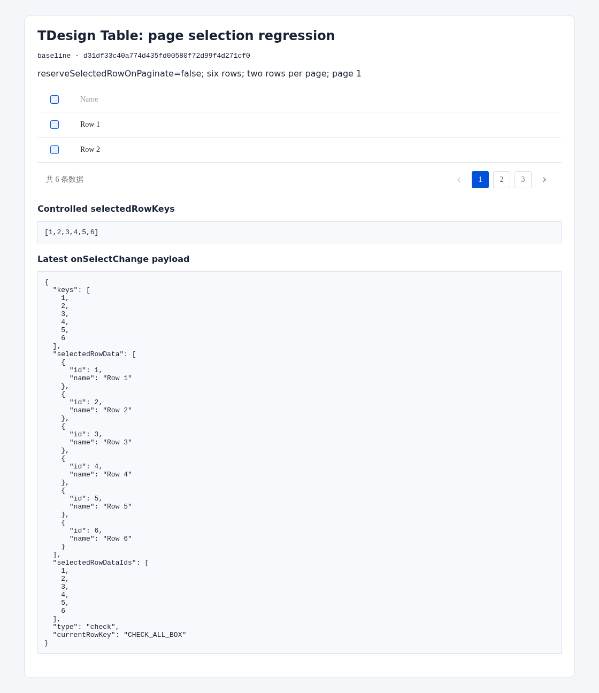
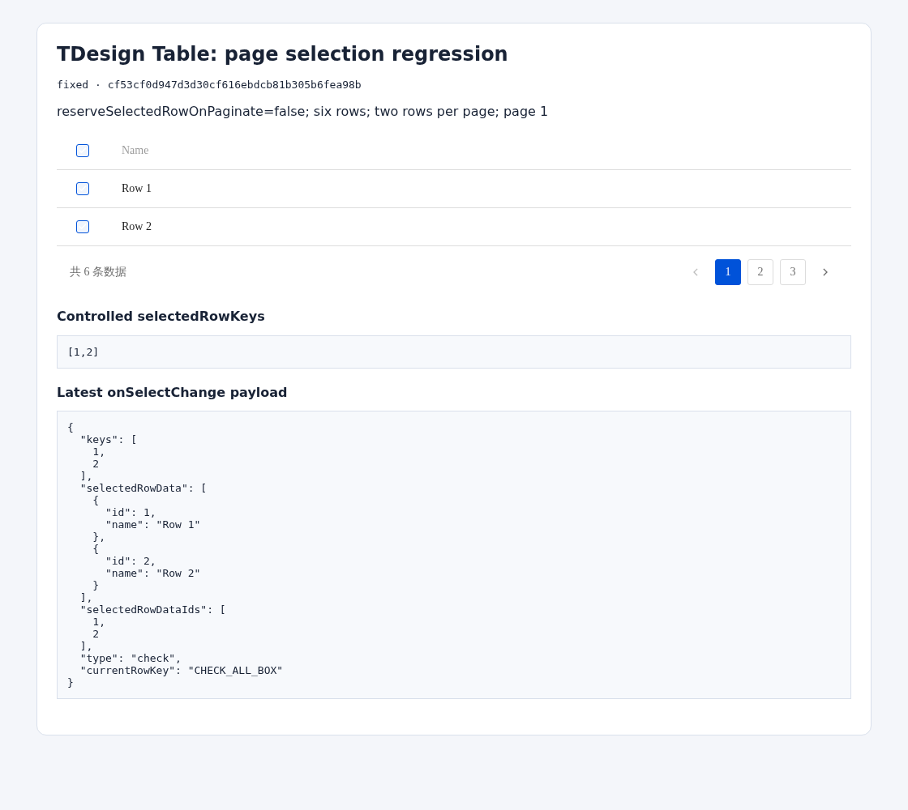

# Table current-page selection: browser evidence

Unedited screenshots from [Actions run 37470186412](https://github.com/dvd233/tdesign-react/actions/runs/37470186412), attempt 1, validation commit `86b0db92c4e19af894fc10961b9bd44fc1bc6d7d`.

- Issue: [Tencent/tdesign-react#4416](https://github.com/Tencent/tdesign-react/issues/4416)
- Browser: Chromium `141.0.7390.37`, Playwright Core `1.56.1`
- Scenario: `reserve-false-initial-1`; step: `initial-select`; page 1
- Fixture: six rows, two per page, `reserveSelectedRowOnPaginate={false}`

## Before

The table displays rows 1 and 2, but the header checkbox returns all six keys and rows.

- Source: `Tencent/tdesign-react@d31df33c40a774d435fd00580f72d99f4d271cf0`
- Artifact: `evidence/baseline/reserve-false-initial-1--01-initial-select.png`
- PNG SHA-256: `fa1a83ddca51cd9c82e58497ce07e649cdc7c545665d24c0ad1660cd7b045f42`

## After

The same interaction returns only the current-page keys `[1,2]` and matching rows.

- Source: `dvd233/tdesign-react@cf53cf0d947d3d30cf616ebdcb81b305b6fea98b`
- Artifact: `evidence/fixed/reserve-false-initial-1--01-initial-select.png`
- PNG SHA-256: `bb2121ba563233e64ef000966ce4e5802a46179e640dbe1759711cb5b4123c81`

The full run covers four scenarios per build: exactly 20 specified baseline payload mismatches, zero fixed mismatches, and no infrastructure/runtime errors. Only synthetic Row 1–6 data and public commit identifiers appear in these images.
